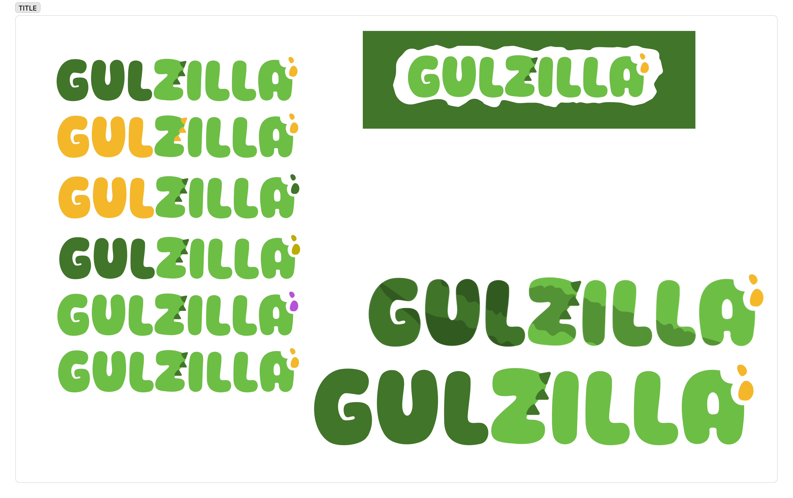
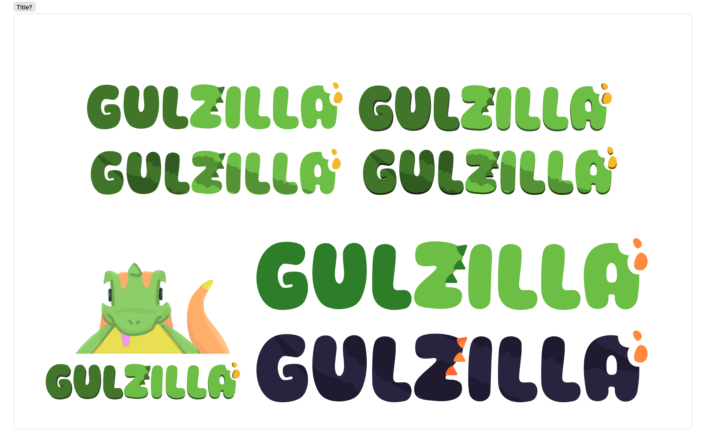
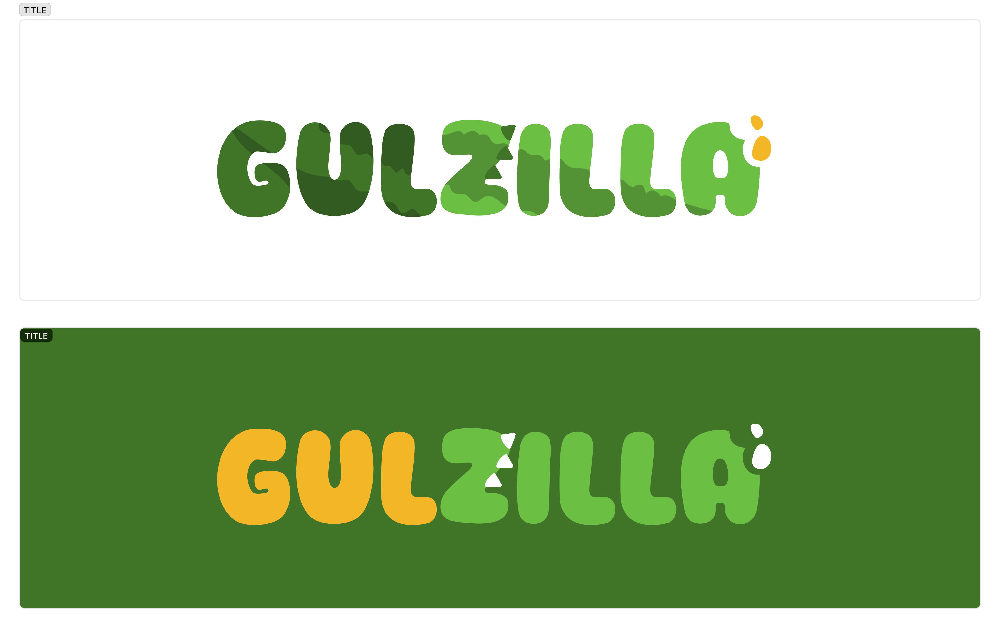
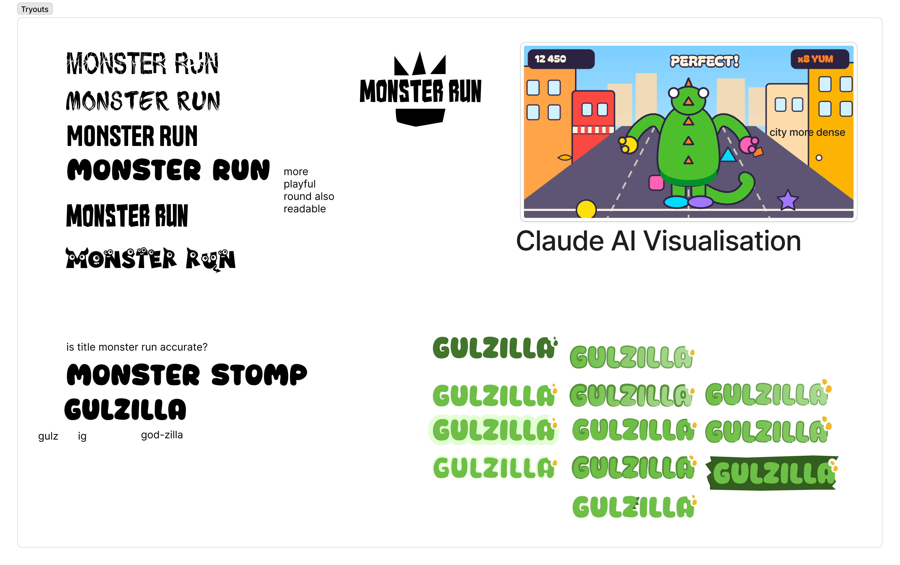
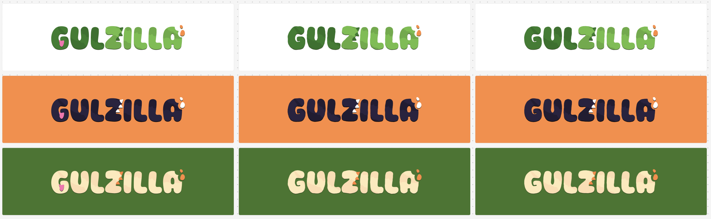
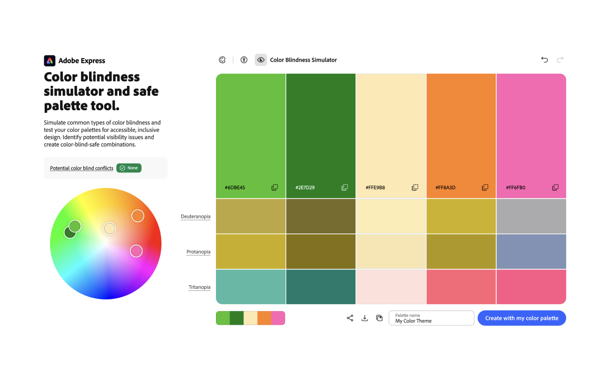
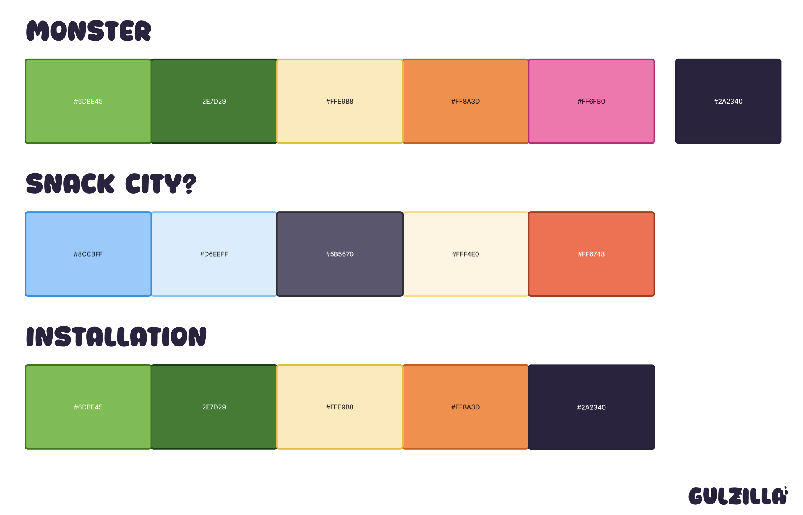

We explored first the font style and that would also indicate what for style we would go for. We ultimately landed on a more rounded but playful font choice: "worktalk". It is a appropriate font for the logo and also portrays the feel we were going for. 

We also worked on the logo and color palette, how they would work together,... We also looked up if the color scheme is good and distinct enough.

