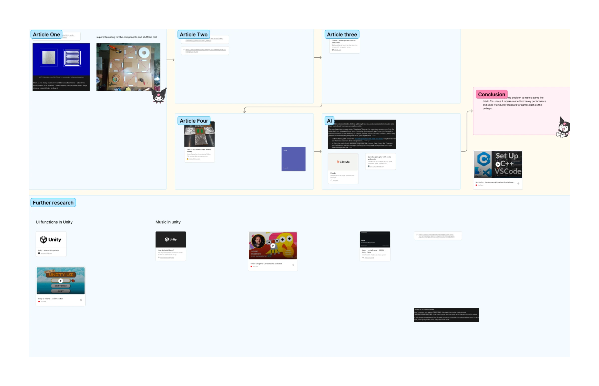

Before we coded anything or knew what tools we wanted to use, i looked up some articles and asked AI what language and IDE would be best. The conclusion of this small reseach is that Unity would be the best performance wise and it's easiest to code in too and definetely with our concept and assets that we need.

Figjam: [link](https://www.figma.com/board/h50vtcR4kMYHgu3JZrGLze/BAP?node-id=166-927&t=MjV2jowvl7h8qgpT-1)
