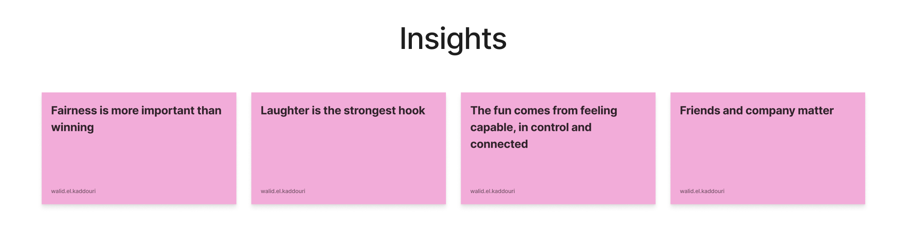
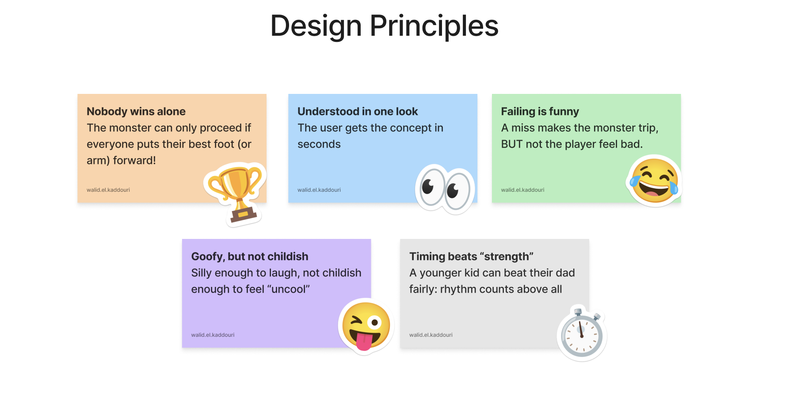

We made an agreement to have a call with the client the same day at 17h, so we kind of had to speed things up. We began researching the target audience children aged 6-12. We also used AI to help us in our research. We were primarily looking for the TA’s interest/ disinterest their “development” and what they do in their free time. The kind of games they play, or lack there of, is also an important theme to the matter. And with our research we created insights for our projects.

