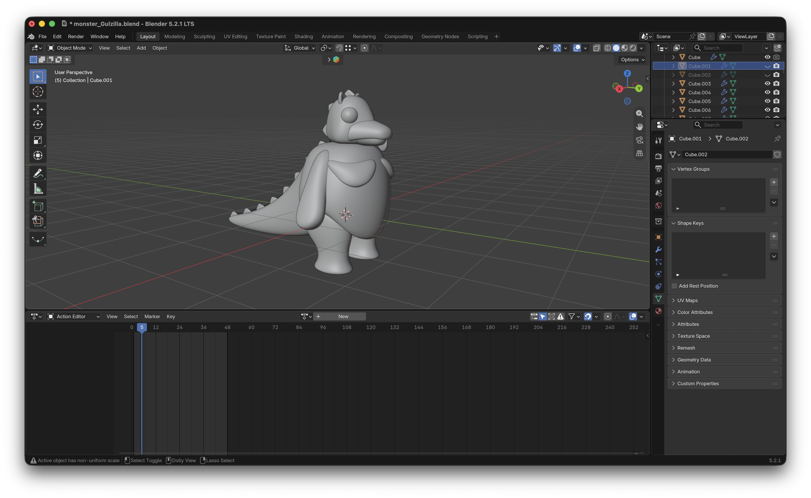
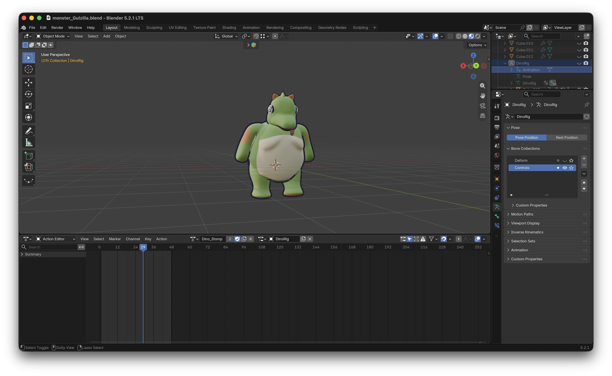

i took Walid's design for our monster and converted it to 3d.
after 3 failed attempts i finally got it 
i started by high poly modelling the general shapes of the monster, the arms,  legs, body and head. 

then i sculpted all general shapes into 2 coherent shapes: the head and the body. 
then i tried to auto rig the model via adobe's mixamo. this didnt work so i rigged it myself. then i textured and animated it. 

