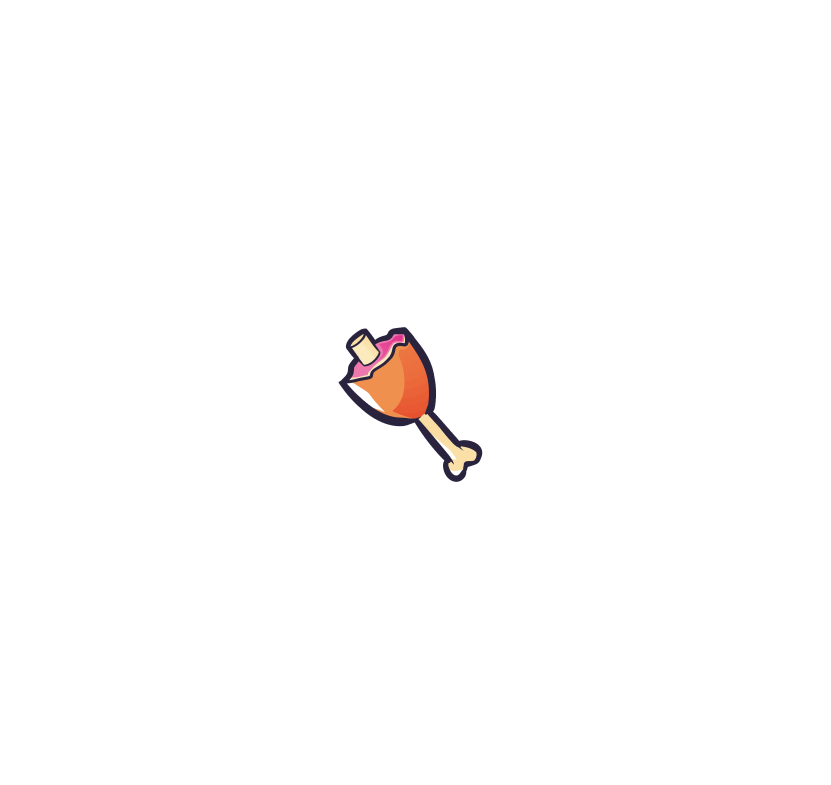

## Week 2

Of course we needed needed some **User interface** to show the user how well they're doing, when they need to interact with the installation, how many live they still have and more!

### Assets
Walid has made some assets for us which i implemented into the screen and the rest i just used as placeholders ( > _nothing is fully definitive yet_)

