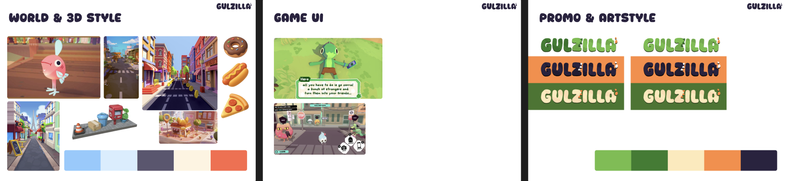

We made 3 styleboards: one for the world and how the 3d assets would look like (still some doubt how thick the outlining would be and how far we woud go into the toon shader/ aaesthethic), one for UI were we made our own designs, and another one for the promo/ general artstyle of the game.

