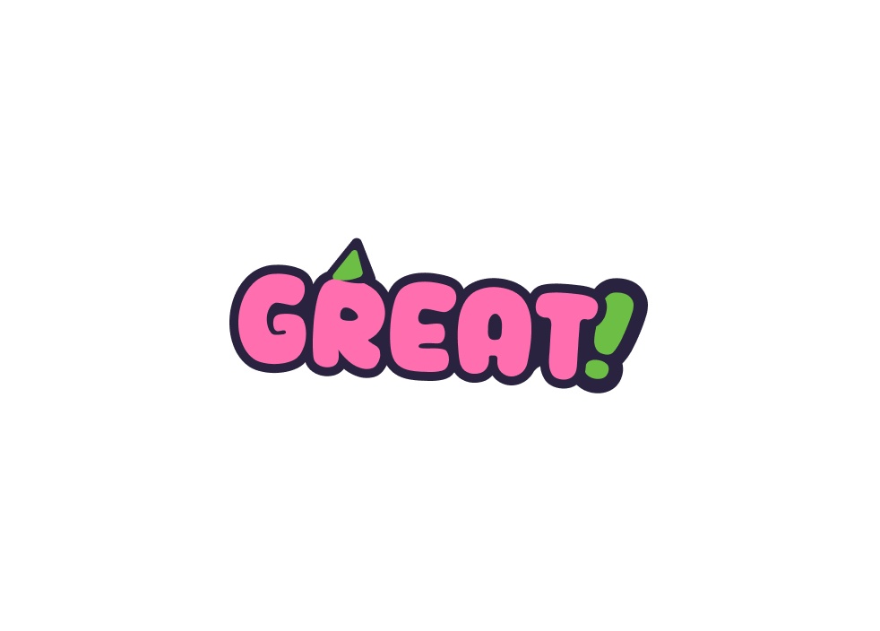
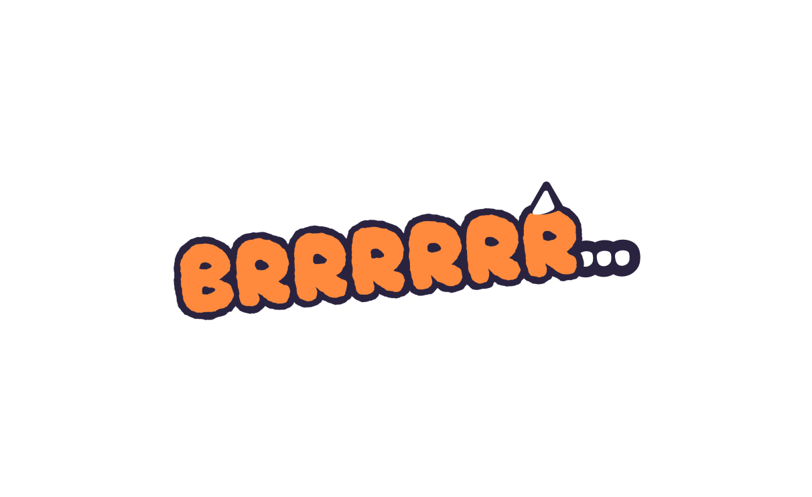
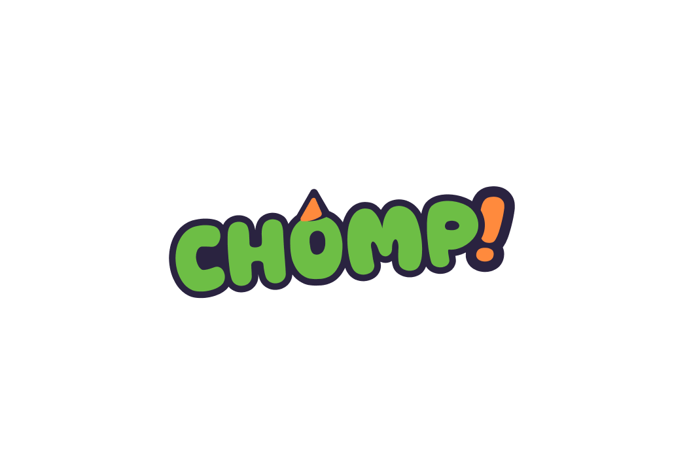

## Week 3

### What?

I added some extra assets made by Walid and also the rythm function work that it calculates how off or right u click ur input when the circle hits the rythm bar.

### Assets

