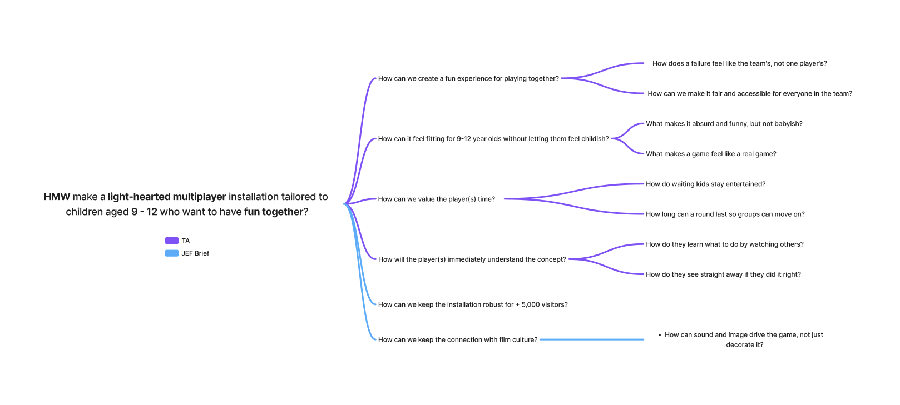

## HMW, Issue Tree and Assumption Matrix ## 

### The How Might We question ###
With the insights and principles in place, we wanted one question that sums up what we are designing for. We landed on:

- How might we make a light-hearted multiplayer installation tailored to children aged 9-12 who want to have fun together?

"Light-hearted" covers the absurd humour, "multiplayer" and "fun together" cover the social side, and "9-12" keeps us focused on our real audience.

### The Issue Tree ###
One question is too big to design from, so we split it into smaller ones. Four branches come from our target audience:

1. Playing together: how does a failure feel like the team's and not one player's, and how do we keep it fair for everyone?
2. Feeling right for 9-12: what makes it absurd and funny without being babyish, and what makes it feel like a real game?
3. Valuing their time: how do we keep waiting kids entertained, and how long should a round last so groups can move on?
4. Understanding it straight away: how do they learn what to do by watching others, and how do they see right away that they did it right?

Two more come from the JEF brief: keeping the installation robust for around 5,000 visitors, and keeping the link with film culture. For that last one, we want sound and image to drive the game, and not just decorate it.

These sub-questions give us a checklist. Each design choice should answer at least one of them.

### The assumption matrix ###
A lot of what we believe about our audience is still a guess. To see which guesses are risky, we placed them on two axes: how certain we are, and how much impact it would have if we're wrong.

- Certain and high impact. Things backed by our research: kids like gaming with friends, absurd humour appeals to them, unfairness and luck put them off, and feeling capable keeps them playing.

- Uncertain and high impact. These are the risky ones. Will kids understand the game just by watching others? Will 11-12-year-olds join something 9-year-olds also enjoy? Do they dare to play in front of strangers? Is playing together more fun for them than competing? Does the honeypot effect really work for them?

- Low impact. Things like whether a volunteer can run it without help, how loud the space is, how much time schools have and whether parents want to join in. These are less about whether the game itself works for kids, and we can check most of them with JEF or during setup.

The top-right corner is what we'll test first with the kids.
