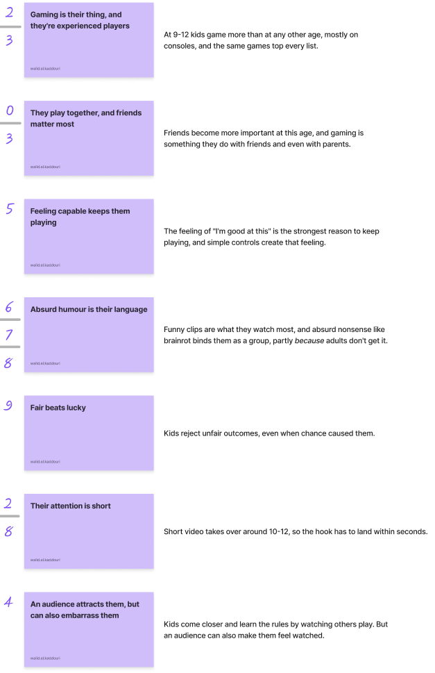

## Insights and design principles ## 

### From research to insights ### 

After the second round of secondary research, we had a board full of facts. To make them useful, we grouped findings that pointed in the same direction and wrote each group as one short insight. Every insight is numbered with the research sections it comes from, so we can always trace it back to a source.

We ended up with 6:

- Gaming is their thing, and they're experienced players. At 9-12 kids game more than at any other age, and the same games top every list.
- They play together, and friends matter most. Gaming is something they do with friends, and even with parents.
- Feeling capable keeps them playing. "I'm good at this" is the strongest reason to keep going, and simple controls create that feeling.
- Absurd humour is their language. Funny clips are what they watch most, and nonsense like brainrot binds them as a group, partly because adults don't get it.
- Fair beats lucky. Kids reject unfair outcomes, even when chance caused them.
Their attention is short. Short video takes over around 10-12, so the hook has to land within seconds.
- An audience attracts them, but can also embarrass them. They come closer and learn the rules by watching, but being watched can make them self-conscious.
Updating the design principles

We already had five design principles from the concept phase. We held each one against the insights to see if it still made sense, and changed what didn't fit.
