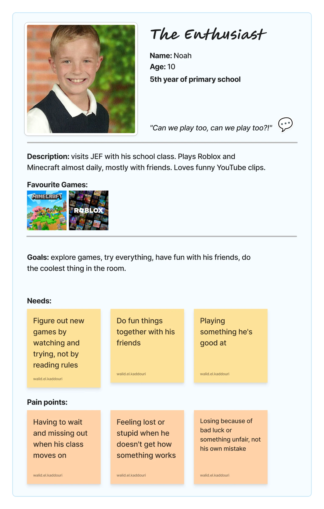
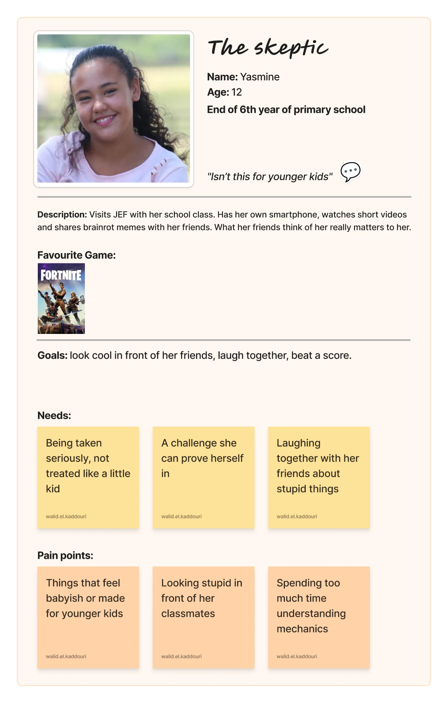
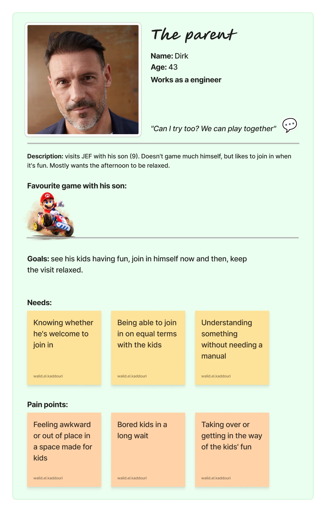

## Personas ##

### Why personas ###
Pain points and needs are useful, but they're quite abstract. To keep real people in mind while designing, we made 3 personas. Each one is based on our research and stands for a different type of visitor we expect at JEF and our installation. Each persona has a short description, a favorite game, goals, needs and pain points, all linked back to what we found earlier.

### 1. Noah, the enthusiast (10) ###
Noah is in his 5th year of primary school and visits JEF with his class. He plays Roblox and Minecraft almost every day, mostly with friends, and loves funny YouTube clips. His quote: "Can we play too, can we play too?!" embodies his enthusiasms regarding gaming (together). 

He wants to try everything and do the coolest thing in the room. He learns new games by watching and trying, not by reading rules. What bothers him is waiting too long and missing out when his class moves on, feeling confused when he doesn't get how something works, and losing because of bad luck.

**Noah is the easiest to win over. The challenge with him is keeping it fair, quick and exciting.**

### 2. Yasmine, the skeptic (12) ###
Yasmine is at the end of primary school and also comes with her class. She has her own smartphone, watches short videos and shares brainrot memes with her friends. What her friends think of her really matters. Her favorite game is Fortnite. Her quote: "Isn't this for younger kids?" embodies her skepticism

She wants to look cool, laugh with her friends and beat a score. She needs to be taken seriously and wants a challenge she can prove herself in. Her biggest fears are things that feel babyish, looking stupid in front of her classmates, and wasting time on complicated mechanics.

**Yasmine is the hardest to convince, so if the game works for her, it probably works for most of the group.**

### 3. Dirk, the parent (43) ###
Dirk works as an engineer and visits JEF with his 9-year old son. He doesn't game much, but likes to join in when it's fun. Mario Kart is their favorite game to play together on occasional evenings. His quote: "Can I try too? We can play together." embodies his desire to play together with his son without taking over.

He mostly wants a relaxed afternoon and to see his kid having fun. He needs to know whether he's welcome to join, and wants to play on equal terms without a manual. He doesn't want to feel out of place in a space made for kids, or take over the game.

### What they changed ###
Each persona pushes the design in a different direction. Noah keeps us focused on speed, fairness, excitement. Yasmine on tone and challenge, and Dirk on making it clear that adults can join in without taking over.
