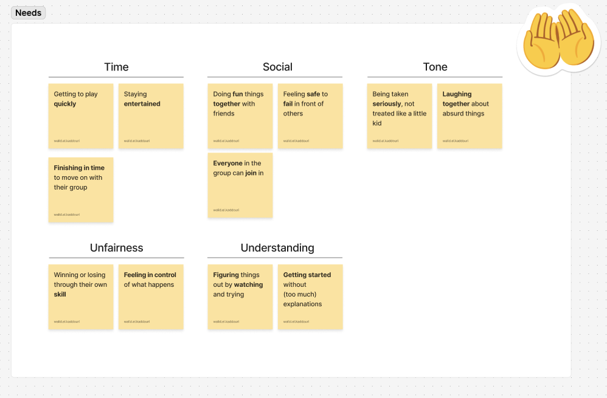

## Pain points and Needs ##

### Why we did this ###
Our insights told us what 9-12-year olds like. We also wanted to know what can ruin an installation for them. So we listed everything that could frustrate a kid at a busy festival, and then turned each frustration into a need.

### Pain points ###
We grouped the pain points into 5 themes.

- Time: having to wait too long, or being rushed.
- Social: looking stupid in front of friends or classmates, being separated from their group, being left out, or missing out.
- Tone: humor that misses, getting bored, and games that feel too babyish.
- Unfairness: losing because of bad luck instead of their own mistake, and flimsy input that doesn't react.
- Understanding: feeling lost or confused, and spending too much time figuring out the mechanics.

The social theme is the biggest. At this age, how you look in front of your friends matters a lot. That matches what we found in the research about being watched.

### Needs ###
For every theme we wrote down what kids need instead. We kept the same five groups, so each pain point has a clear answer that way.

- Time: getting to play quickly, staying entertained, and finishing in time to move on with their group.
- Social: doing fun things together with friends, feeling safe to fail in front of others, and making sure everyone in the group can join in.
- Tone: being taken seriously and not treated like a little kid, and laughing together about absurd things.
- Unfairness: winning or losing through their own skill, and feeling in control of what happens.
- Understanding: figuring things out by watching and trying, and getting started without long explanations.

### What we do with it ###
The needs work as a checklist for the design. Short rounds and something to watch while waiting answer the time needs. A shared team score answers "feeling safe to fail". Solid pads that react straight away answer "feeling in control". Most needs also link back to one of our design principles, so they help us check if we're still on track.
