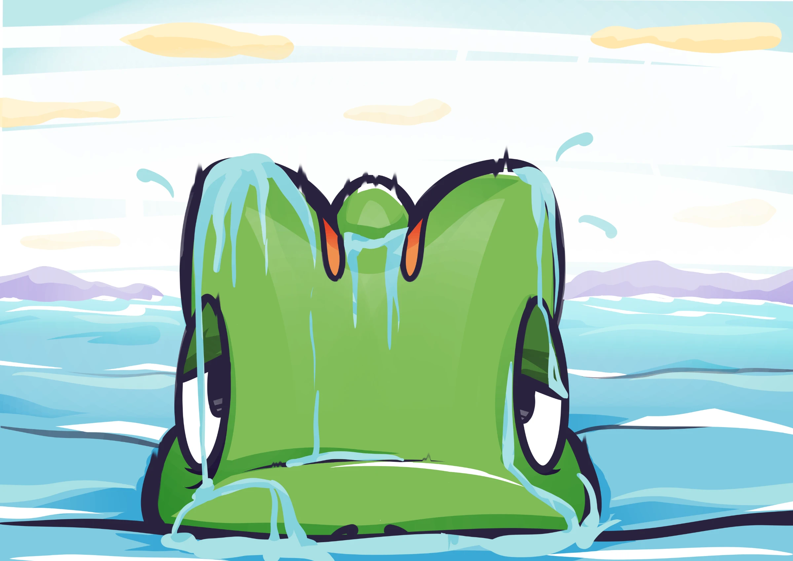
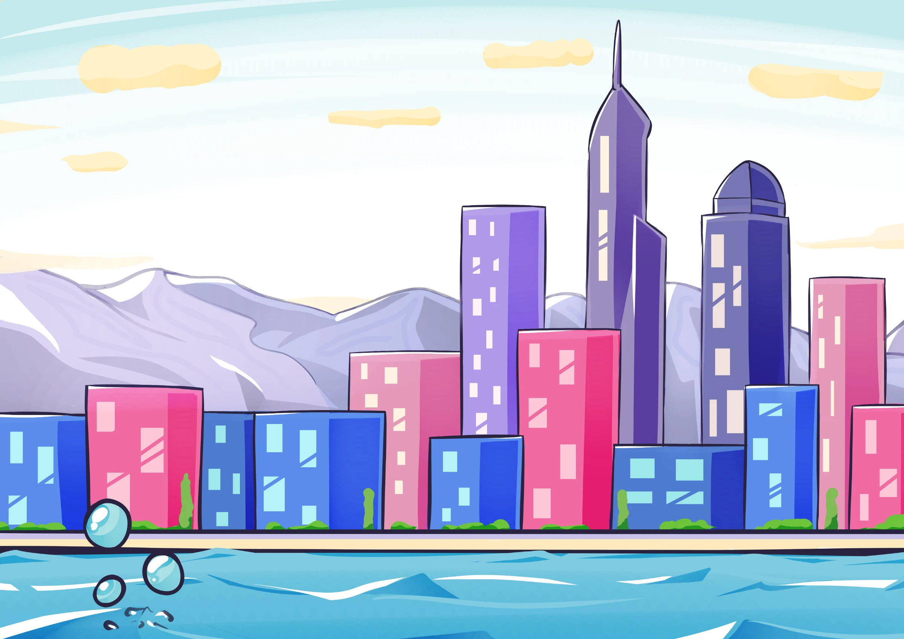
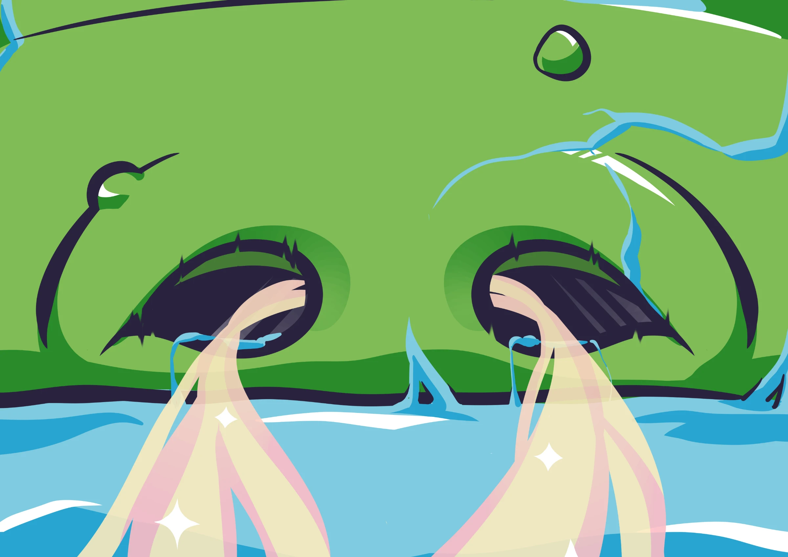
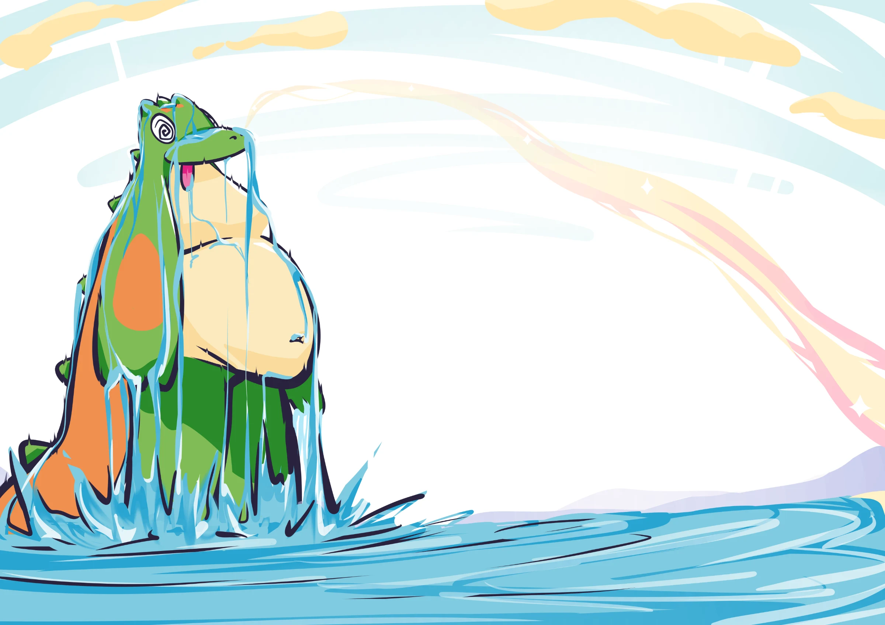
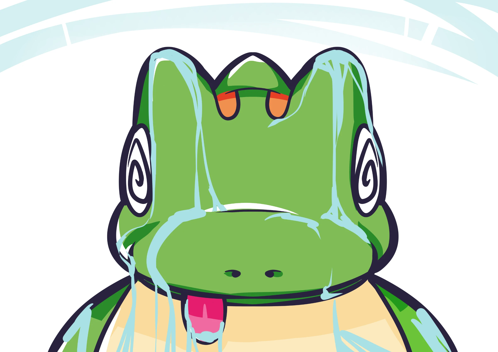

**Drawn storyline that will play before the game starts**

The TA will see a short intro that explains why they're playing: the monster is hungry and needs to be fed. To keep the intro short and easy to follow, we tell it as a 2D illustrated story instead of in 3D. The intro has to stay under 15 second -> because of a queue at the festival/ to hold the attention span. So every scene has to tell its part of the story in one look, without text.

