**Feedback**

You can go more over the top with things. Now it moves really slow but you can give it more depth so he runs through buildings and stuff... don’t make it so flat... give it like a event/ mini game in the game itself to spice things up.

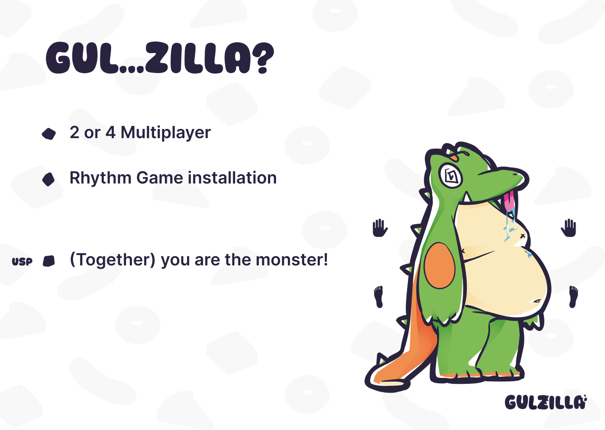

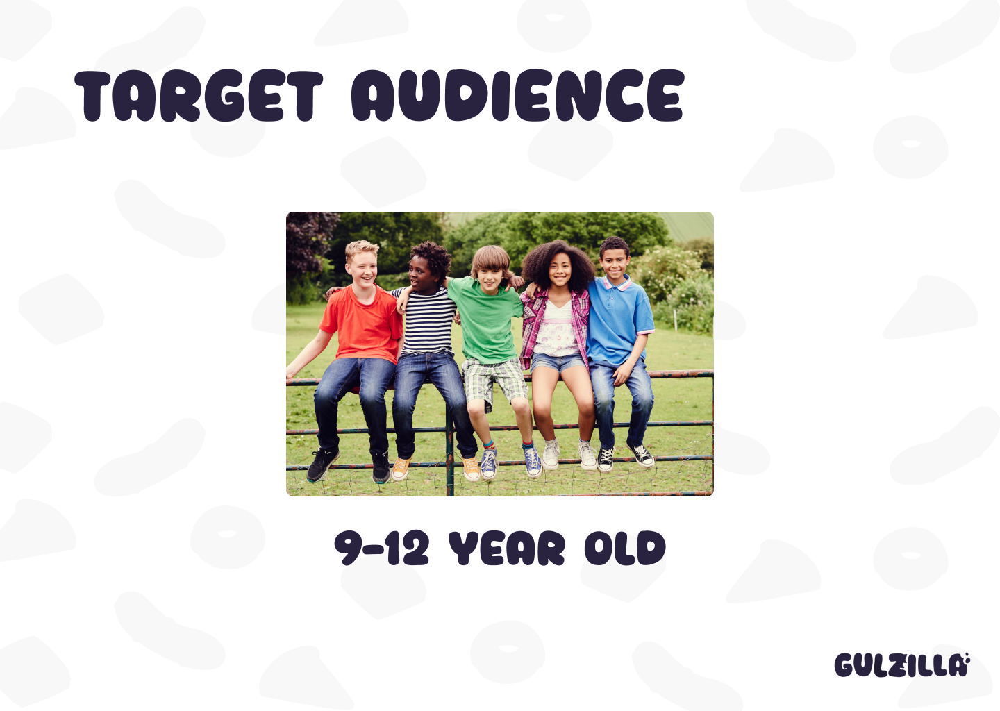

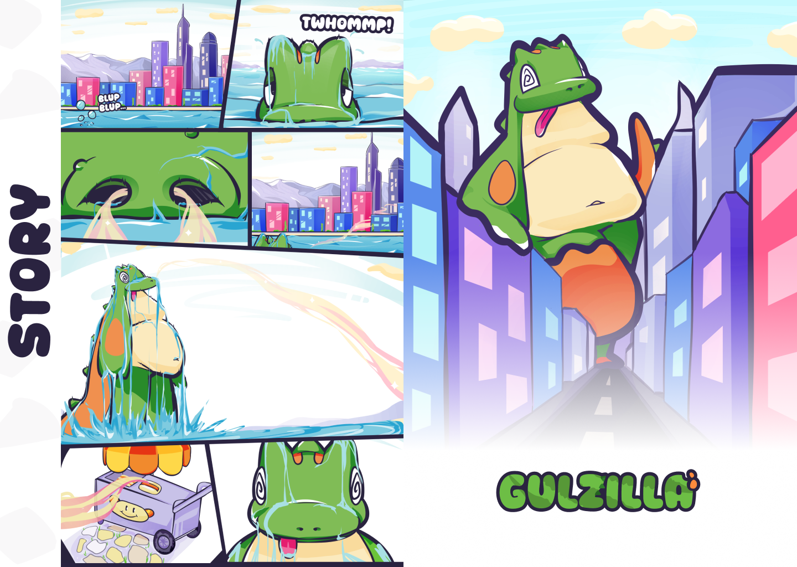

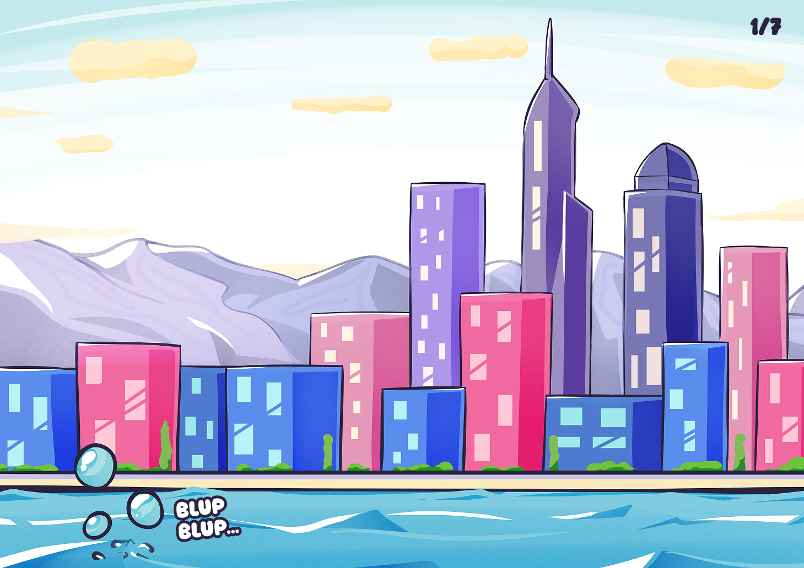

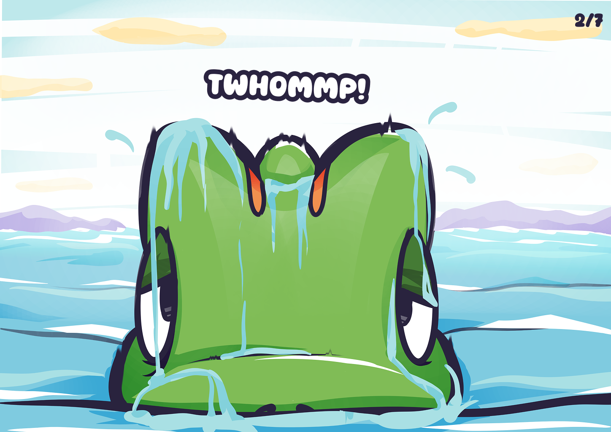

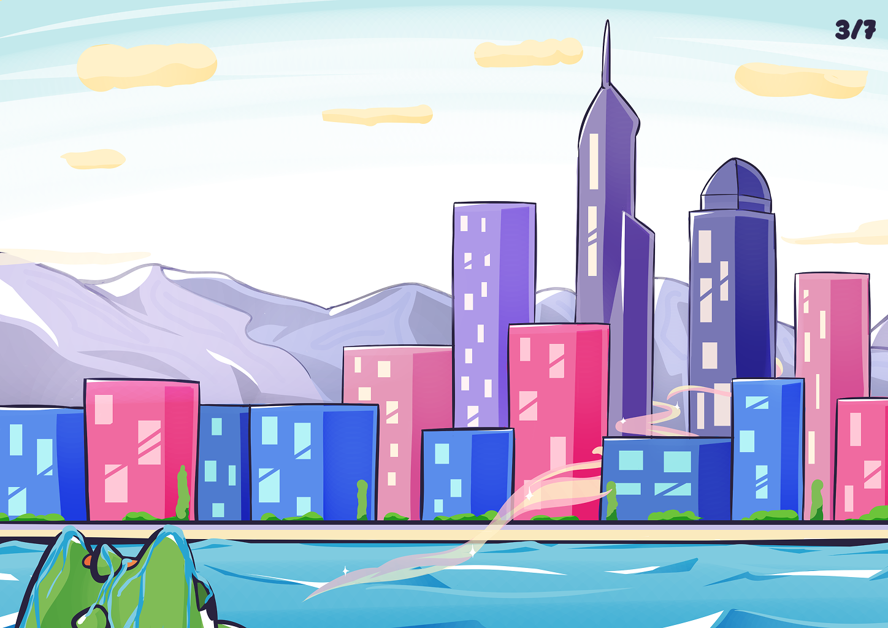

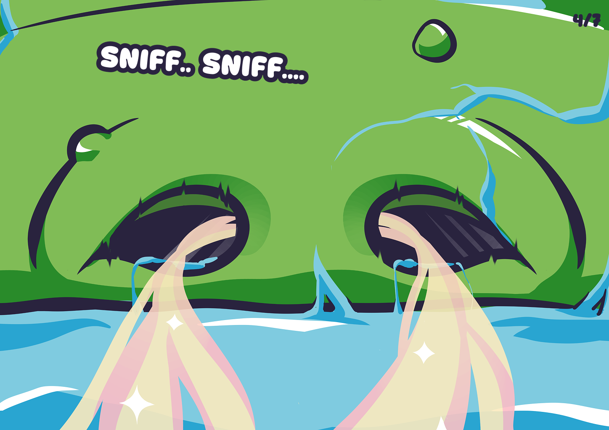

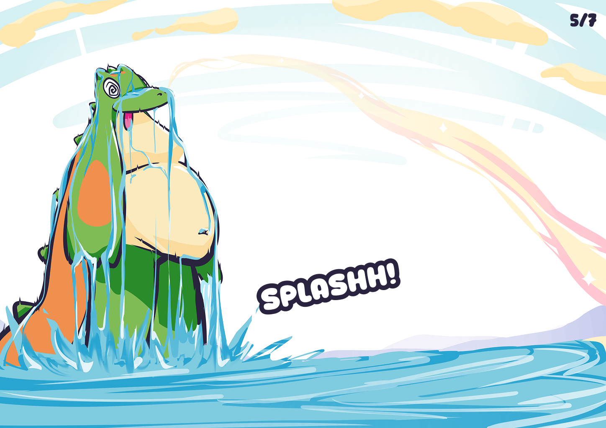

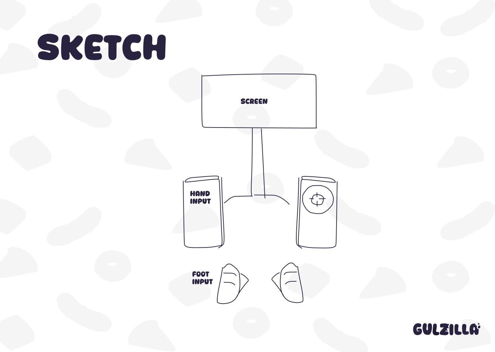

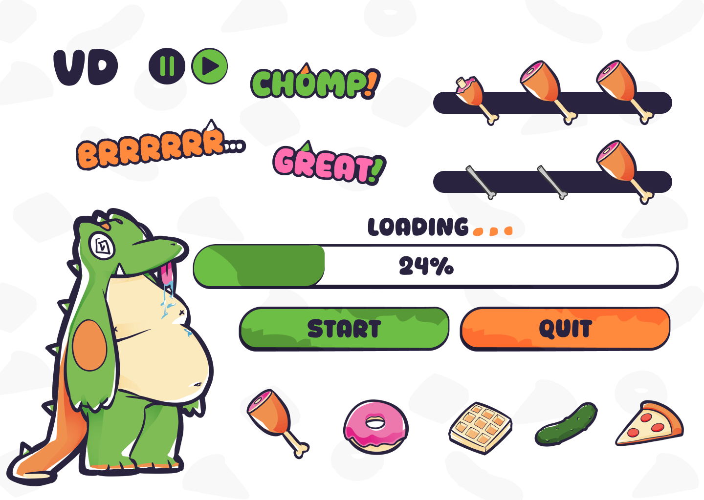

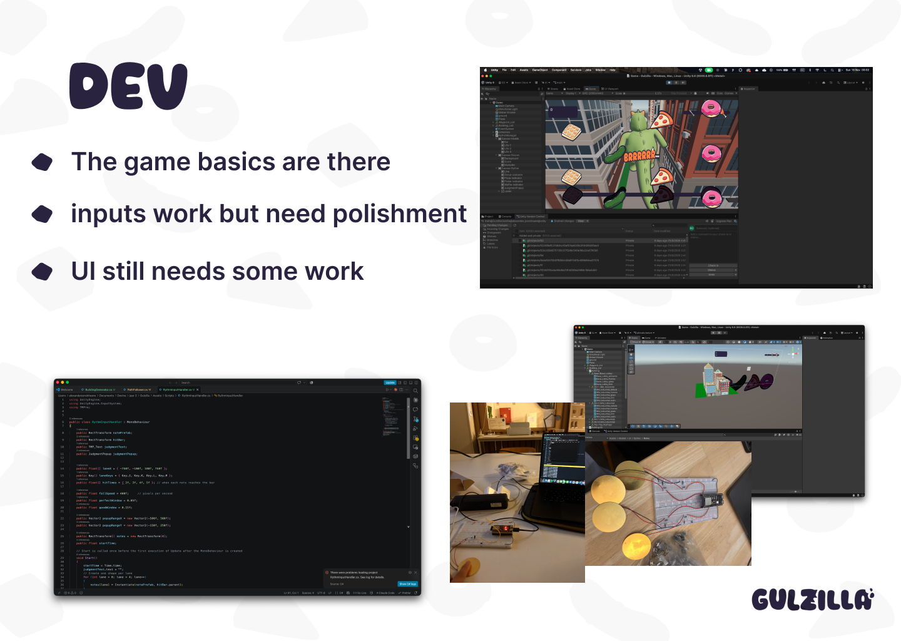

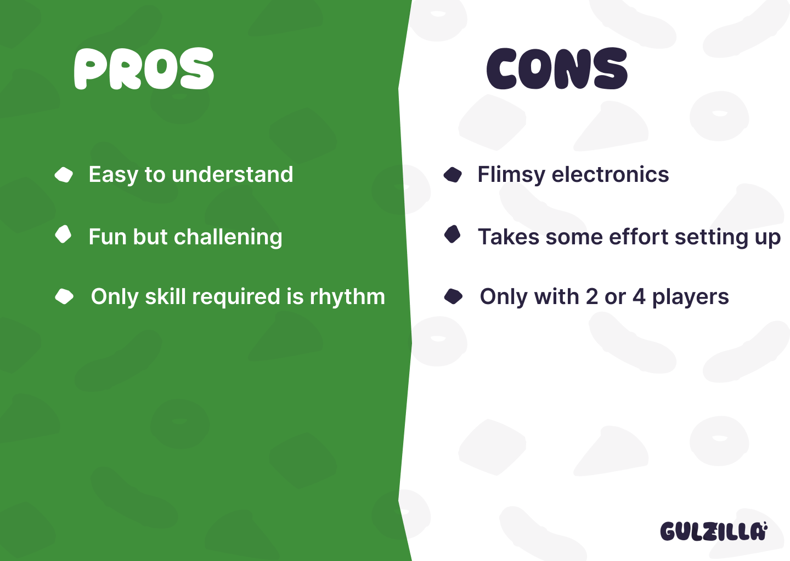

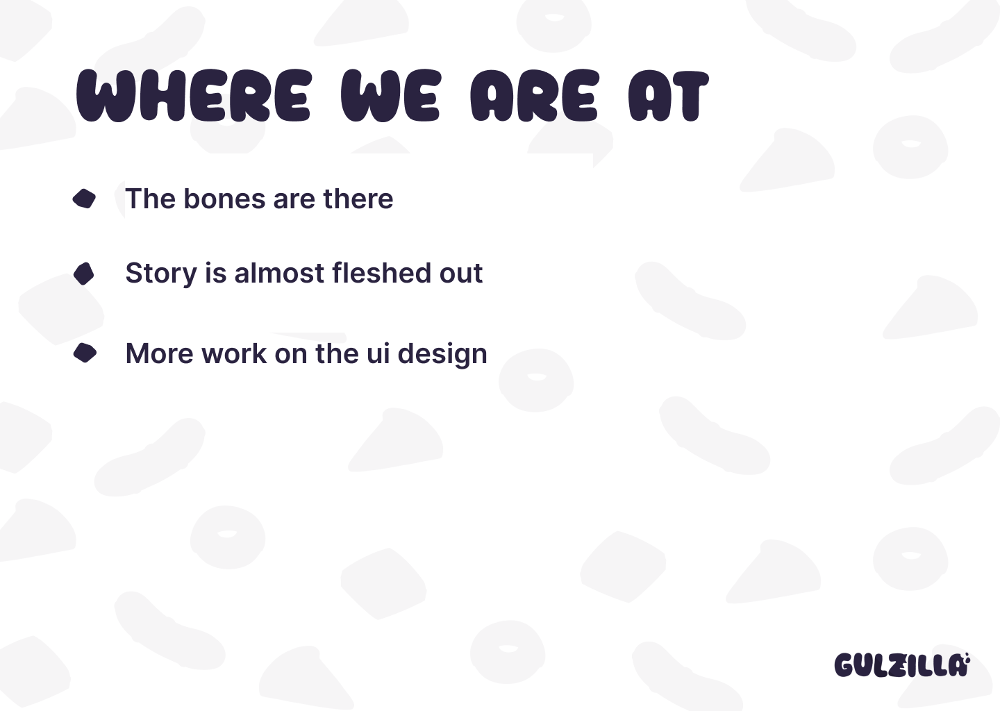

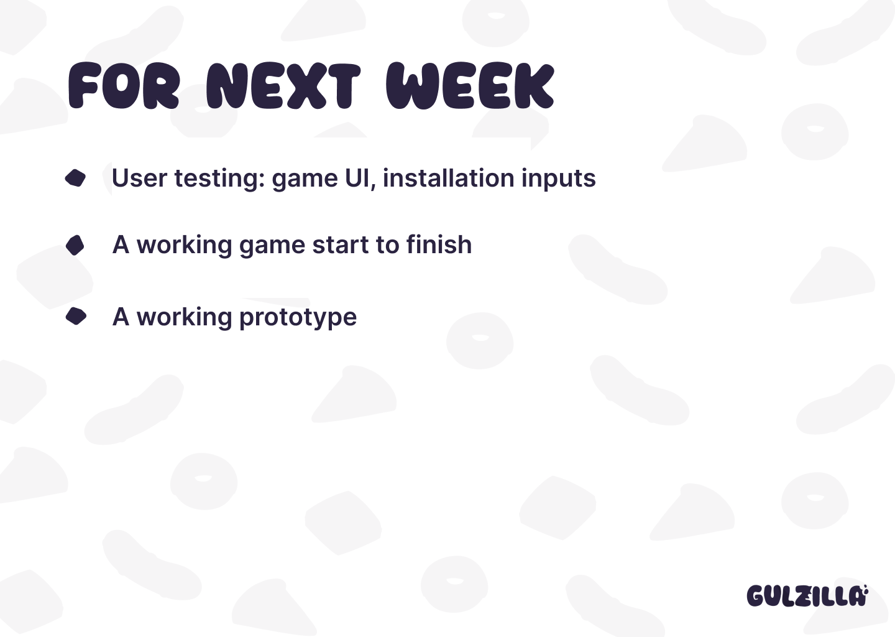

