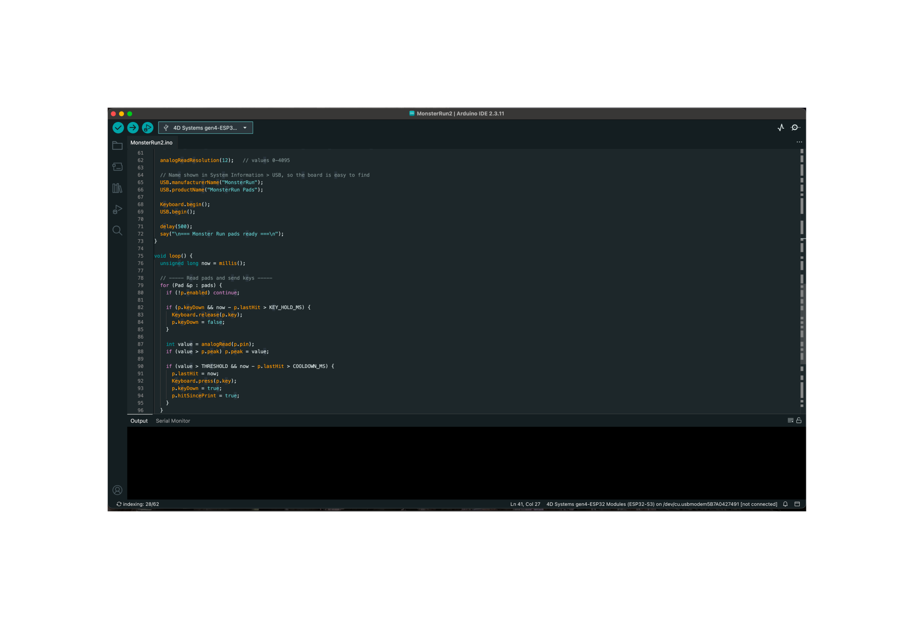
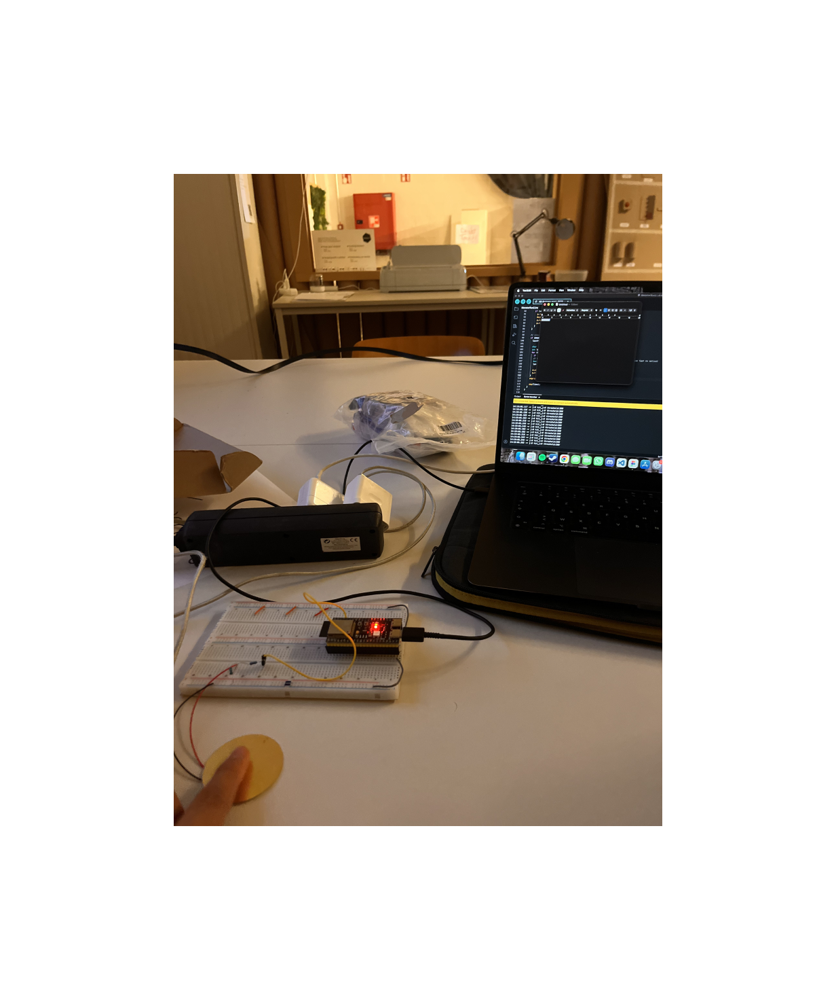

## **Physical input**

Our concept and everything else wouldn't work without the physical inputs because they make it fun, interactive and cool. What i did here was just make the basics and functionality of our physical components by writing a script in ArduinoIDE that listens to the user input of the physical components through the esp32-S3 and converts them into keyboard output.

The code is optimised and every parameter is easily adjustable to the scene.

I struggled with the keyboard output of it the most because i didn't think well enough about the functionality of both ports of the esp32.

One ports is only used to read and receive code (uploads) and the other acts as an external accessoire on mac that i can effectively use as a keyboard.
