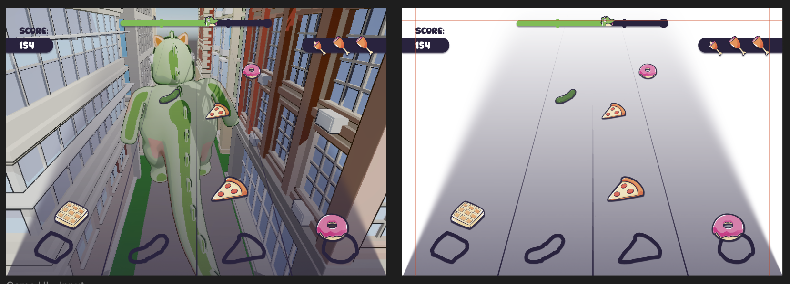

**Making the UI for the game**

Before the game starts, the players have to tell how many of them there are 2/4. Keeping in mind our TA (9-12) the only controllers are four food pads they hit with their hands and feet. So I designed this flow to work with clarity + without buttons.

(The installation also has to recover from mistakes by itself = fix automatic return after 10 sec. of no inputs)

**Making the UI for the gameplay**

This is the screen our TA will look at while playing, it has to be readable in a split second. Food falls down four lanes toward outlines at the bottom of the screen. Each outline = one pad. I gave the lanes a bit of perspective so they follow the street and the food seems to fly out of the city at you. And that also leaves room for the health bar, progress bar, score

I tested a lot of versions to get this more or less right. Thin outlines got lost against the buildings, so I made them thicker. The lane lines also needed to be strong enough to see during the game itself, not only in the mockup.
